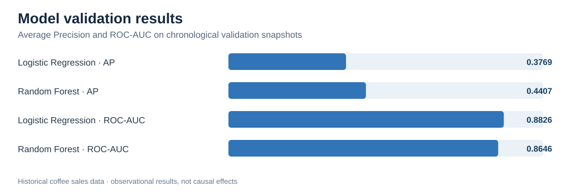
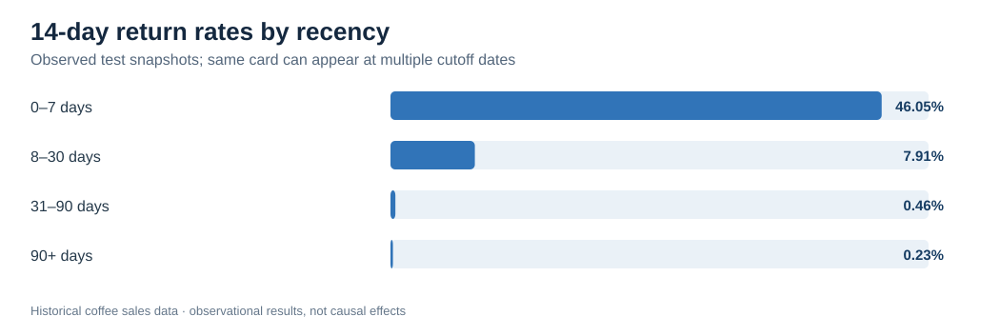

# Coffee Customer Intelligence & Repeat-Purchase Prediction

**Python · pandas · scikit-learn · Customer analytics · Time-based machine learning**

[](https://colab.research.google.com/github/RamaKsibati/coffee-customer-retention-ml/blob/main/Coffee_Customer_Retention.ipynb)

## Overview

**Business question:** Can historical coffee-machine purchase behavior help predict whether an identifiable payment card will be used again within the next **14 days**?

This project connects transactional customer intelligence with supervised learning. It investigates purchase frequency, recency, and spending; estimates visits from timestamped transactions; constructs historical prediction snapshots; and compares Logistic Regression with Random Forest.

**Important distinction:** This is *repeat-purchase prediction*, **not verified permanent churn**. A card identifier is not necessarily one unique person, and cardless transactions cannot be linked to a purchasing history.

## Project at a glance

| Data preparation | Observed result |
|---|---:|
| Source transaction rows | 3,898 |
| Card-linked transactions | 3,547 |
| Distinct card identifiers | 1,316 |
| Estimated visits (30-minute grouping rule) | 2,886 |
| Cards with 2+ estimated visits | 339 |
| Historical prediction snapshots | 31,486 |
| Distinct cards in snapshots | 1,260 |
| 14-day returns in all snapshots | 1,118 (3.55%) |

**Data source:** [Coffee Sales by ihelon (Kaggle)](https://www.kaggle.com/datasets/ihelon/coffee-sales). The notebook retrieves CSV files using `kagglehub`; the source can change over time. The published results refer to the version analyzed in the uploaded executed notebook (through March 23, 2025).

## Model comparison



**Chronological validation** (8,461 snapshots; observed return rate 2.58%):

| Model | Average Precision | ROC-AUC |
|---|---:|---:|
| Logistic Regression | 0.3769 | **0.8826** |
| Random Forest | **0.4407** | 0.8646 |

**Selection:** Random Forest was chosen provisionally because **Average Precision** was the primary metric for the rare positive class. Logistic Regression performed better on ROC-AUC; neither method won on every metric.

**Later-period retrospective evaluation of the selected Random Forest**, using the notebook's chronological train/validation/test split (9,445 snapshots; 2.54% positive rate):

| Metric | Result |
|---|---:|
| Accuracy | 0.9323 |
| Precision (threshold 0.5) | 0.2286 |
| Recall (threshold 0.5) | 0.7000 |
| F1 (threshold 0.5) | 0.3446 |
| Average Precision | 0.4276 |
| ROC-AUC | 0.9185 |

Confusion matrix (rows = actual [no return, return]; columns = predicted [no return, return]): `[[8638, 567], [72, 168]]`.

The test period was previously examined during exploration. These should be described as **retrospective exploratory results**, not a completely untouched final holdout or production performance estimate.

## What customer behavior showed



| Recency before prediction | Test snapshots | Returned within 14 days | Return rate |
|---|---:|---:|---:|
| 0–7 days | 354 | 163 | 46.05% |
| 8–30 days | 670 | 53 | 7.91% |
| 31–90 days | 1,960 | 9 | 0.46% |
| 90+ days | 6,461 | 15 | 0.23% |

Recency was the largest impurity-based Random Forest feature importance in an earlier exploratory fit (`RecencyDays`: 0.4035; `TotalSpent`: 0.2068; `TotalVisits`: 0.1797; `CustomerAgeDays`: 0.1479; `AvgVisitSpending`: 0.0621). These values **do not imply causality**.

## How the analysis works

1. **Audit raw data:** Combine two CSVs with different columns, parse mixed timestamps correctly, check missing card identifiers and duplicate transaction records.
2. **Estimate visits:** For each card, consecutive transactions at most 30 minutes apart are grouped into one estimated visit. This is a heuristic.
3. **Explore customer behavior:** Compare visit frequency, recency, spending, customer segments, and intervals between visits.
4. **Engineer historical features:** At weekly cutoff dates, compute `TotalVisits`, `TotalSpent`, `AvgVisitSpending`, `RecencyDays`, and `CustomerAgeDays` using **past** visits only.
5. **Define outcome:** `Returned14Days = 1` if a later recorded visit occurs within 14 days after the cutoff, otherwise 0. Only cutoff dates with a full future observation window are used.
6. **Model and evaluate:** Compare a prior-probability baseline, scaled Logistic Regression, and Random Forest; then examine chronological validation and later-period test results.

## Business recommendations

- **Engage recent occasional visitors:** Test whether targeted loyalty messages increase actual repeat visits compared with a randomized control group.
- **Investigate previously frequent visitors with declining activity:** Explore service, product, or convenience factors before committing to discount campaigns.
- **Avoid blanket incentives:** Many people would return without an offer; measure **incremental visits and profit**, not just predicted return probability.
- **Track customer activity over time:** Monitor recency distributions, repeat-visit rates, and campaign performance rather than relying solely on classification accuracy.

These are *testable recommendations*, not effects demonstrated by the observational data. A return-probability model does not identify which customers will respond to a marketing intervention.

## Reproduce the notebook

1. Open [Coffee_Customer_Retention.ipynb](Coffee_Customer_Retention.ipynb) using the **Open in Colab** badge above.
2. Choose **Runtime → Run all**. The notebook uses `kagglehub` to fetch the data; no local Python installation is required.
3. Review the raw-data and timestamp parsing sections before interpretation. Because the public Kaggle dataset can be updated, your outputs may not exactly match these archived figures.

## Limitations and responsible interpretation

- **Sample:** One coffee-machine dataset; findings may not generalize to other cafés or demographics.
- **Identifiers:** Cards are pseudonymous identifiers, not necessarily people; cash purchases lack linked card histories.
- **Visits:** The 30-minute transaction-grouping rule is a proxy for a visit, not a verified visit ID.
- **Repeated observations:** Weekly snapshots share cards and may have overlapping future outcome windows. Results are correlated and should not be interpreted as independent customer observations.
- **Class imbalance:** Only 3.55% of all historical snapshots were positive; accuracy by itself is misleading.
- **Changing population:** Older inactive cards remain eligible for later snapshots, changing observed return rates over time.
- **Model selection:** Earlier exploration inspected test outcomes, so reported test results are not a pristine holdout.
- **Labels:** "No 14-day return observed" is **not** the same as permanent customer churn.
- **No causal inference:** Feature importance and high return rates among recent purchasers do not demonstrate that promotions or contact will alter behavior.

## Repository structure

```text
coffee-customer-retention-ml/
├── README.md
├── Coffee_Customer_Retention.ipynb
└── images/
    ├── validation_models.svg
    └── return_rate_by_recency.svg
```

## Skills demonstrated

Python · pandas · data validation · feature engineering · customer segmentation · supervised classification · class imbalance · chronological validation · scikit-learn · model evaluation · business storytelling
